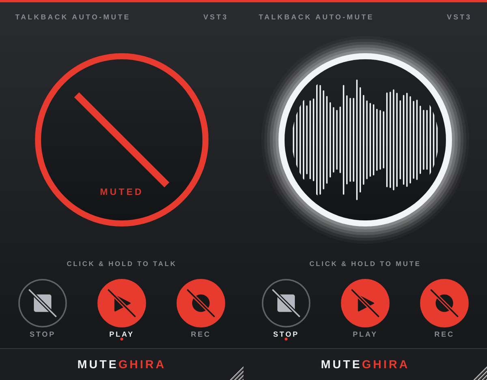

# MUTEGHIRA

Plugin **VST3** (Windows + macOS Intel/Apple Silicon) que silencia o deja pasar un canal
según el estado del transporte del DAW. Pensado para el micrófono de **talkback / listen**:
se abre solo cuando el DAW está detenido y se mutea cuando reproduce o graba, mostrando
siempre el estado en grande. Inspirado en *Muteomatic* (SoundRadix), con otra estética
(oscura, acento rojo, estilo Fender Studio Pro).



## Uso

**Talkback** — crear un canal AUX/BUS con salida al cue-mix y el micrófono de talkback como
entrada, poner MUTEGHIRA en el último slot de inserts y dejar **PLAY** y **REC** activados
(es la configuración por defecto). Con el DAW parado el micrófono pasa; al reproducir o grabar se silencia.

**Corta-colas de efectos** — poner MUTEGHIRA en la pista y activar **STOP**, desactivar **PLAY**:
corta delays/reverbs cuando el transporte está detenido (útil en hosts que siguen procesando en stop, como Pro Tools).

| Elemento | Qué hace |
|---|---|
| Botón **STOP** (relleno) | Muteo cuando el transporte está detenido |
| Botón **PLAY** (relleno) | Muteo cuando el transporte reproduce |
| Botón **REC** (relleno) | Muteo cuando el transporte graba (solo hosts que informan el estado de grabación) |
| Círculo rojo tachado | Canal muteado (estático) |
| Círculo blanco + waveform | Canal pasando audio, con la forma de onda en tiempo real |
| `NO AUDIO INPUT` | El host no está enviando audio al plugin |
| Click y mantener en el círculo | Invierte temporalmente el estado: *push‑to‑talk* si está muteado, *push‑to‑mute* si está pasando |

Los tres botones y el override (`Mute Override`) son parámetros automatizables.
El cambio de estado usa un fundido de 12 ms para evitar clics. Soporta mono y estéreo
(o cualquier configuración con igual cantidad de entradas y salidas).

## Instalación

Descargá el zip de la última ejecución de **Actions** (artifact) o de **Releases** y copiá `MUTEGHIRA.vst3`:

- **Windows:** `C:\Program Files\Common Files\VST3\`
- **macOS:** `/Library/Audio/Plug-Ins/VST3/` (o `~/Library/Audio/Plug-Ins/VST3/`)

En macOS el bundle viene firmado *ad-hoc* (sin certificado de Apple Developer). Si el sistema
lo bloquea al descargarlo: `xattr -cr /Library/Audio/Plug-Ins/VST3/MUTEGHIRA.vst3`

## Compilar

Requiere CMake ≥ 3.22 y un compilador C++17 (Visual Studio 2019+/Xcode). JUCE 8.0.9 se descarga solo.

```sh
cmake -S . -B build -DCMAKE_BUILD_TYPE=Release
cmake --build build --config Release --target MUTEGHIRA_VST3
# -> build/MUTEGHIRA_artefacts/Release/VST3/MUTEGHIRA.vst3
```

Tests de lógica + capturas de la UI (Linux/macOS/Windows):

```sh
cmake -S . -B build -DMUTEGHIRA_BUILD_TESTS=ON
cmake --build build --target MuteghiraTests
build/MuteghiraTests_artefacts/Release/MuteghiraTests --snapshot out/
```

## Licencia

Construido con [JUCE](https://juce.com) (AGPLv3 / licencia comercial) y el SDK de VST3 (MIT).
Si distribuís binarios, el proyecto debe publicarse bajo AGPLv3 (o contar con licencia comercial de JUCE).
*VST es una marca registrada de Steinberg Media Technologies GmbH.*
